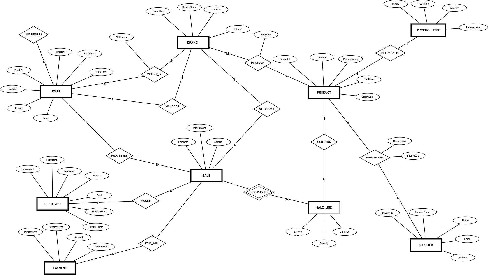

# Süpermarket Yönetim Sistemi

Ankara Üniversitesi Bilgisayar Mühendisliği, BLM2058 Veritabanı Yönetim Sistemleri dersi dönem projesi. Birden fazla şubesi olan bir market zinciri için personel, ürün, stok, tedarikçi, müşteri, satış ve ödeme bilgilerini tek bir MySQL veritabanında topladık.

## ER Diyagramı

Diyagramı draw.io'da Elmasri & Navathe gösterimiyle çizdik. 9 varlık ve 12 ilişki var. Bir fişteki her ürün satırı (SALE_LINE), satışa bağlı zayıf varlık olarak modellendi. Kaynak dosya: [`diyagram/er-diyagrami.drawio`](diyagram/er-diyagrami.drawio)

## Veritabanı

`supermarket_mysql.sql` dosyasında 13 tablo, 8 trigger, 5 view ve demo verileri bulunuyor.

- Satış yapılınca şubedeki stok düşer, stok yetmiyorsa satış engellenir.
- Fiş toplamı satış kalemlerinden hesaplanır, ödemeler bu toplamı aşamaz.
- Sadakat puanı sıfırın altına inemez.
- Stok yeniden sipariş seviyesine inince `REORDER_LOG` tablosuna kayıt düşer.

## Çalıştırma

1. `supermarket_mysql.sql` dosyasını MySQL Workbench'te çalıştırın. `new_schema` veritabanı demo verileriyle kurulur.
2. `arayuz` klasöründe `npm install` ve `npm start` çalıştırın, ardından `http://localhost:3000` adresini açın. MySQL şifresi `DB_PASSWORD` ortam değişkeninden okunur.

Arayüz Node.js/Express ile yazıldı. Satış, ürün, stok, müşteri, personel ve rapor ekranları var.

## Hazırlayanlar

Elif Feyza Güneş, Yusuf Tarlak
